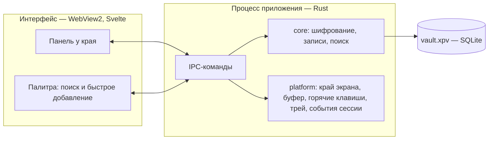

# План реализации XonkyPass

Документ описывает архитектуру, ключевые механизмы и этапы разработки.
Платформа — только Windows 10 22H2 / 11 x64. Стек — Rust + Tauri 2 + Svelte 5.

Содержание:

1. [Цели и принципы](#1-цели-и-принципы)
2. [Данные и шифрование](#2-данные-и-шифрование)
3. [Архитектура](#3-архитектура)
4. [Ключевые механизмы](#4-ключевые-механизмы)
5. [Интерфейс](#5-интерфейс)
6. [Этапы разработки](#6-этапы-разработки)
7. [Как мы работаем](#7-как-мы-работаем)
8. [Тестирование](#8-тестирование)
9. [Риски](#9-риски)
10. [Бэклог (после 1.0)](#10-бэклог-после-10)
11. [Открытые вопросы](#11-открытые-вопросы)

---

## 1. Цели и принципы

1. **Скорость важнее всего.** Окна создаются один раз при запуске и потом только показываются и прячутся. Поиск идёт по индексу в памяти.
2. **Минимум действий.** Найти и скопировать пароль — не больше 2 действий. Сохранить новый пароль с сайта — не больше 3.
3. **Секреты не покидают Rust без явного действия.** Интерфейс получает только названия, логины, теги. Пароль уходит в интерфейс, только когда пользователь нажал «показать» или «изменить».
4. **Работа без интернета.** Приложение не делает сетевых запросов, если пользователь сам их не включил (например, загрузку иконок сайтов).
5. **Всё управляется с клавиатуры.** Каждое действие доступно без мыши.

### Бюджеты производительности

| Метрика                                   | Цель                                          |
| ----------------------------------------- | --------------------------------------------- |
| Начало появления панели/палитры           | ≤ 50 мс от триггера                           |
| Поиск на каждое нажатие (10 000 записей)  | ≤ 5 мс                                        |
| Разблокировка (Argon2id)                  | 0,5–1 с (намеренно, это защита от перебора)   |
| Холодный старт до иконки в трее           | ≤ 1 с                                         |
| Память                                    | ≤ 100 МБ вместе с процессами WebView2         |
| CPU в простое                             | ≈ 0 %                                         |
| Размер установщика                        | ≤ 10 МБ                                       |

---

## 2. Данные и шифрование

### 2.1 Ключи

```
Мастер-пароль ──Argon2id──► ключ слота «password» ─┐
Ключ восстановления ──────► ключ слота «recovery» ─┼─► расшифровывает ─► Ключ хранилища (256 бит, случайный)
Windows Hello (TPM) ──────► ключ слота «hello» ────┘                         │
                                                                             ▼
                                                     XChaCha20-Poly1305 для каждой записи
```

- **Ключ хранилища** — случайные 256 бит. Создаётся один раз и никогда не хранится открыто.
- **Слоты ключа** (как в LUKS). Ключ хранилища лежит в нескольких зашифрованных копиях: одна открывается мастер-паролем, другая ключом восстановления, третья через Windows Hello. Поэтому смена мастер-пароля перешифровывает только один слот, а не всю базу.
- **Argon2id:** по умолчанию m = 64 МиБ, t = 3, p = 4, соль 16 байт. Параметры подбираются при создании хранилища на ~0,5–1 с и сохраняются в слоте.
- **Шифрование:** XChaCha20-Poly1305, случайный nonce (24 байта) на каждое шифрование.
- **Привязка (AAD):** `vault_id ‖ item_id ‖ имя поля ‖ версия формата`. Шифртекст одной записи нельзя подставить в другую.
- **Неверный пароль** определяется по ошибке расшифровки слота. Отдельный «проверочный хэш» не хранится.
- **Ключ восстановления:** случайные 128 бит, показываются в виде групп символов (`XXXX-XXXX-…`). Пользователь сохраняет его на «аварийный лист» (PDF или печать).
- **В памяти** ключи хранятся в типах `secrecy`/`zeroize`, страницы закреплены через `VirtualLock`. При блокировке всё затирается.

### 2.2 Файлы на диске

| Путь                                        | Что                                         |
| ------------------------------------------- | ------------------------------------------- |
| `%APPDATA%\XonkyPass\vault.xpv`             | хранилище (SQLite)                          |
| `%APPDATA%\XonkyPass\settings.json`         | настройки (не секретные: край, клавиши…)   |
| `%APPDATA%\XonkyPass\backups\`              | автоматические резервные копии (зашифрованы) |
| `%LOCALAPPDATA%\XonkyPass\logs\`            | журналы (без секретов, ротация 7 дней)      |

### 2.3 Схема БД

Версия схемы хранится в `PRAGMA user_version`, миграции встроены в бинарник.
Режимы: `journal_mode = WAL`, `secure_delete = ON`, `foreign_keys = ON`.

```sql
CREATE TABLE vault (
  id           INTEGER PRIMARY KEY CHECK (id = 1),
  vault_id     BLOB    NOT NULL,          -- 16 случайных байт
  format_ver   INTEGER NOT NULL,
  created_at   INTEGER NOT NULL
);

CREATE TABLE key_slots (
  kind         TEXT PRIMARY KEY,          -- 'password' | 'recovery' | 'hello'
  params       TEXT NOT NULL,             -- JSON: алгоритм, параметры KDF, соль
  wrapped_key  BLOB NOT NULL              -- nonce ‖ шифр(ключ хранилища)
);

CREATE TABLE items (
  id           BLOB PRIMARY KEY,          -- UUIDv7
  meta         BLOB NOT NULL,             -- nonce ‖ шифр(JSON метаданных)
  secret       BLOB NOT NULL,             -- nonce ‖ шифр(JSON секретов)
  created_at   INTEGER NOT NULL,          -- unix, мс
  updated_at   INTEGER NOT NULL,
  deleted_at   INTEGER,                   -- не NULL = в корзине
  revision     INTEGER NOT NULL DEFAULT 1 -- задел под синхронизацию
);

CREATE TABLE item_history (
  id           INTEGER PRIMARY KEY,
  item_id      BLOB NOT NULL REFERENCES items(id) ON DELETE CASCADE,
  data         BLOB NOT NULL,             -- шифр(снимок meta + secret)
  created_at   INTEGER NOT NULL
);

CREATE TABLE item_usage (                 -- для сортировки «часто/недавно»
  item_id      BLOB PRIMARY KEY REFERENCES items(id) ON DELETE CASCADE,
  use_count    INTEGER NOT NULL DEFAULT 0,
  last_used_at INTEGER
);
```

Открыто лежат только идентификаторы, даты и счётчики использования. Названия, логины, сайты, теги, тексты заметок и пароли зашифрованы.

### 2.4 Содержимое записей

**Логин.** `meta` — то, что нужно для поиска и списка:

```json
{
  "v": 1,
  "kind": "login",
  "title": "GitHub",
  "username": "user@example.com",
  "urls": ["github.com"],
  "apps": ["GitHubDesktop.exe"],
  "tags": ["работа", "dev"],
  "favorite": true,
  "has_totp": true
}
```

`secret` — то, что расшифровывается только по запросу:

```json
{
  "password": "…",
  "totp": "otpauth://totp/…",
  "notes": "…",
  "fields": [{ "name": "PIN", "value": "1234", "hidden": true }]
}
```

**Заметка.** Текст лежит в `meta`, чтобы по нему работал поиск:

```json
{ "v": 1, "kind": "note", "title": "Wi-Fi дома", "body": "…markdown…", "tags": ["дом"], "favorite": false }
```

Поле `secret` у заметки пустое (зарезервировано под скрытые поля).

**Теги.** При сравнении приводятся к нижнему регистру, хранятся в исходном написании. Пробелы заменяются на `-`.

---

## 3. Архитектура



### 3.1 Окна

| Окно      | Назначение                                     | Поведение                                                    |
| --------- | ---------------------------------------------- | ------------------------------------------------------------ |
| `panel`   | список, карточки, редактирование, настройки    | пристыковано к краю или работает как обычное окно            |
| `palette` | поиск, быстрое добавление пароля и заметки     | появляется по центру активного монитора по горячей клавише   |

Оба окна создаются при старте скрытыми: без рамки, вне панели задач и Alt+Tab (`WS_EX_TOOLWINDOW`). Это один Svelte-бандл, который выбирает экран по имени окна.

### 3.2 Структура репозитория

```
XonkyPass/
├─ Cargo.toml                 # workspace
├─ crates/
│  └─ core/                   # без зависимостей от Tauri и Windows → тестируется где угодно
│     ├─ src/
│     │  ├─ crypto.rs         # AEAD, AAD, ключи с zeroize
│     │  ├─ keyslot.rs        # слоты ключа хранилища
│     │  ├─ recovery.rs       # ключ восстановления (Base32 + контрольная сумма)
│     │  ├─ kdf.rs            # Argon2id, калибровка
│     │  ├─ model.rs          # Login, Note, Tag, ввод/вывод
│     │  ├─ store.rs          # SQLite, миграции, транзакции
│     │  ├─ vault.rs          # create/unlock/lock/CRUD/корзина/история
│     │  ├─ search.rs         # индекс в памяти, разбор запроса, ранжирование
│     │  ├─ matching.rs       # сопоставление доменов (eTLD+1) и приложений
│     │  ├─ generator.rs      # пароли и парольные фразы, оценка надёжности
│     │  ├─ totp.rs
│     │  ├─ backup.rs
│     │  └─ import/, export/
│     └─ migrations/
├─ src-tauri/
│  ├─ src/
│  │  ├─ main.rs, lib.rs
│  │  ├─ commands/            # тонкий слой IPC над core
│  │  ├─ state.rs             # открытое хранилище, таймеры блокировки
│  │  ├─ tray.rs, hotkeys.rs, settings.rs, error.rs
│  │  └─ platform/            # всё Win32, под cfg(windows)
│  │     ├─ dock.rs           # край экрана, курсор, анимация
│  │     ├─ clipboard.rs      # буфер без истории, автоочистка
│  │     ├─ foreground.rs     # активное окно, exe, заголовок
│  │     ├─ browser_url.rs    # адрес из браузера через UI Automation
│  │     ├─ session.rs        # блокировка Windows, сон
│  │     ├─ capture.rs        # защита от захвата экрана
│  │     ├─ hello.rs          # Windows Hello
│  │     └─ app_icons.rs      # иконки из exe
│  ├─ capabilities/           # минимальные права Tauri
│  └─ tauri.conf.json
├─ src/                       # Svelte
│  ├─ lib/
│  │  ├─ api/                 # типизированные обёртки над invoke() + mock-бэкенд
│  │  ├─ stores/              # состояние (руны Svelte 5)
│  │  ├─ components/          # UI-кит
│  │  └─ i18n/                # строки интерфейса (ru)
│  ├─ views/                  # Setup, Unlock, Panel, Palette, QuickAdd, QuickNote, Settings…
│  ├─ App.svelte
│  └─ main.ts
├─ docs/                      # PLAN.md, FORMAT.md, TESTING.md
└─ .github/workflows/         # CI: Linux (ядро, фронтенд) + Windows (полная сборка)
```

### 3.3 Зависимости

**Rust:** `tauri` 2 (`tray-icon`), `tauri-plugin-global-shortcut`, `tauri-plugin-autostart`, `tauri-plugin-single-instance`, `tauri-plugin-dialog`, `rusqlite` (`bundled`), `argon2`, `chacha20poly1305`, `rand`, `zeroize`, `secrecy`, `uuid` (v7), `serde`/`serde_json`, `thiserror`, `tracing`, `nucleo-matcher`, `zxcvbn`, `totp-rs`, `psl`, `csv`, `keepass`, `windows`.

**Фронтенд:** Svelte 5, TypeScript, Vite, `@tauri-apps/api`, иконки Lucide, `marked` + `DOMPurify` (Markdown в заметках), Vitest.

Почему не SQLCipher: он требует OpenSSL, что сильно усложняет сборку под Windows. Шифрование на уровне записей на чистом Rust даёт ту же защиту данных и позволяет держать пароли зашифрованными даже в памяти.

### 3.4 IPC: команды и события

| Команда                                              | Что делает                                              |
| ---------------------------------------------------- | ------------------------------------------------------- |
| `vault_status`                                       | есть ли хранилище, заблокировано ли                     |
| `vault_create(password)`                             | создать хранилище, вернуть ключ восстановления          |
| `vault_unlock(password)` / `vault_unlock_hello`      | разблокировать                                          |
| `vault_lock`                                         | заблокировать, затереть ключи и индекс                  |
| `vault_change_password(old, new)`                    | перешифровать слот `password`                           |
| `items_search(query, limit)`                         | результаты поиска (только метаданные)                   |
| `item_get(id)`                                       | карточка без секретов                                   |
| `item_reveal(id, field)`                             | секрет по явному действию (показать/изменить)           |
| `item_create` / `item_update` / `item_delete`        | создание, изменение, перенос в корзину                  |
| `item_restore` / `item_purge`                        | корзина                                                 |
| `item_copy(id, field)`                               | Rust сам кладёт логин/пароль/код 2FA в буфер            |
| `item_history(id)`                                   | история паролей                                         |
| `tags_list`, `tag_rename`, `tag_merge`               | теги                                                    |
| `generate_password(opts)`, `password_strength(pw)`   | генератор и оценка                                      |
| `context_get`                                        | активное приложение/сайт на момент горячей клавиши      |
| `settings_get` / `settings_set`                      | настройки                                               |
| `dock_set(edge, monitor)` / `dock_pin(bool)`         | режим панели                                            |
| `import_*`, `export_*`, `backup_*`                   | данные                                                  |

| Событие (Rust → UI)  | Когда                                                        |
| -------------------- | ------------------------------------------------------------ |
| `vault://locked`     | хранилище заблокировано (таймер, Win+L, сон, вручную)        |
| `palette://open`     | открыть палитру в режиме `search` / `new-login` / `new-note` |
| `context://updated`  | адрес из браузера определился (асинхронно)                   |
| `clipboard://cleared`| буфер очищен по таймеру                                      |
| `dock://state`       | панель показана, скрыта или закреплена                       |

Ошибки передаются в интерфейс как `{ code, message }`. Тексты для пользователя берутся из `i18n` по коду.

---

## 4. Ключевые механизмы

### 4.1 Панель у края экрана

**Режимы:** сверху, слева, справа или обычное окно. Выбираются монитор и размер панели.

**Размеры по умолчанию:**
- слева или справа: ширина 400 px (можно менять от 320 до 640), высота — вся рабочая область монитора без панели задач;
- сверху: 720×520 px, по центру монитора.

**Как определяется подведение мыши.** Фоновый поток раз в 30–50 мс вызывает `GetCursorPos`. Это практически не нагружает CPU. Глобальный хук мыши (`WH_MOUSE_LL`) сознательно не используется: он замедляет всю систему и не нравится антивирусам.

Панель выезжает, только если выполнены все условия:
- курсор в зоне 1–2 px у края;
- край **внешний**, то есть за ним нет другого монитора (стык двух мониторов не считается);
- курсор не ближе 10 px к углу экрана, чтобы не мешать системным активным углам;
- курсор пробыл у края 150–200 мс (задержка настраивается), это защищает от случайных срабатываний;
- не зажата кнопка мыши (`GetAsyncKeyState`), то есть пользователь не перетаскивает окно или выделение;
- активное приложение не в полноэкранном режиме (`SHQueryUserNotificationState`), например не запущена игра или презентация;
- для верхнего края курсор находится в пределах ширины панели.

**Показ** идёт без перехвата фокуса (`SWP_NOACTIVATE`), чтобы набор текста в другом приложении не прерывался. Фокус панель получает по клику.

**Анимация:** выезд за ~150 мс с замедлением в конце (ease-out), окно сдвигается через `SetWindowPos` в главном потоке. Если анимация будет дёргаться, есть запасной вариант — мгновенный показ.

**Скрытие:**
- если панель открыта наведением и по ней не кликали — курсор ушёл с панели больше чем на 8 px и не вернулся за 400 мс;
- если по панели кликнули — по потере фокуса или по Esc;
- открытые диалоги и редактирование блокируют скрытие.

**Закрепление (pin):** панель остаётся на экране, как обычное окно.

**Пристыковка:** если перетащить панель к краю (ближе 20 px), она пристыковывается к нему.

**Индикатор:** по желанию на краю видна тонкая полоска 3 px акцентного цвета.

**Изменения экрана:** DPI каждого монитора (Tauri работает в режиме Per-Monitor v2), смена разрешения, подключение и отключение мониторов, перемещение панели задач. На `WM_DISPLAYCHANGE` и `WM_SETTINGCHANGE` геометрия пересчитывается. Если нужный монитор пропал, панель переходит на основной.

### 4.2 Горячие клавиши и палитра

Регистрируются через `tauri-plugin-global-shortcut`. Если сочетание занято другой программой, в настройках показывается ошибка и предложение выбрать другое.

Последовательность при нажатии:
1. Сохраняется контекст: активное окно (HWND), его процесс (exe) и заголовок.
2. Палитра показывается по центру монитора, на котором находится курсор, и получает фокус.
3. В фоне определяется адрес сайта. Когда он найден, палитра получает событие `context://updated` и уточняет результаты.
4. После действия (скопировали, сохранили) палитра прячется, фокус возвращается в исходное окно (`SetForegroundWindow` по сохранённому HWND).

**Клавиши в палитре:**

| Клавиши        | Действие                                   |
| -------------- | ------------------------------------------ |
| ввод текста    | поиск                                      |
| `↑` `↓`        | выбор                                      |
| `Enter`        | копировать пароль и закрыть                |
| `Shift+Enter`  | копировать логин                           |
| `Ctrl+T`       | копировать код 2FA                         |
| `Ctrl+E`       | открыть запись в панели                    |
| `Ctrl+N`       | новый пароль с текущим контекстом          |
| `Esc`          | закрыть                                    |

### 4.3 Определение приложения и сайта

- **Приложение:** `GetForegroundWindow` → `GetWindowThreadProcessId` → `QueryFullProcessImageNameW` дают exe и полный путь. Заголовок окна — через `GetWindowTextW`.
- **Сайт в браузере** (Chrome, Edge, Firefox, Яндекс.Браузер, Brave, Opera, Vivaldi): адресная строка читается через UI Automation. Для каждого браузера свои правила поиска элемента; локализованные имена элементов не используются. Если не получилось — сайт угадывается по заголовку окна.
- Определение адреса ограничено по времени (≤ 150 мс) и никогда не блокирует показ палитры.

### 4.4 Привязка записей к сервисам

- **Сайты** сравниваются по «регистрируемому домену» (eTLD+1, через список публичных суффиксов): `accounts.google.com` совпадает с `google.com`, но `evil-google.com` — нет. Можно указать точный хост, если нужно строгое совпадение.
- **Приложения** сравниваются по имени exe без учёта регистра. Можно указать полный путь.
- **При поиске из контекста** записи, привязанные к текущему приложению или сайту, идут первыми. Если запрос пустой, показываются только они (плюс избранное).
- **При быстром добавлении** на сайт, где уже есть записи, появляется подсказка: «Для github.com уже есть 2 записи — обновить пароль?». Старый пароль при обновлении уходит в историю.

### 4.5 Поиск

- После разблокировки все `meta` расшифровываются и строится индекс в памяти. Пароли остаются зашифрованными.
- **Синтаксис запроса:**
  - `текст` — нечёткий поиск (nucleo) по названию, логину, сайтам, приложениям, тегам и тексту заметок;
  - `#тег` — обязательный тег, несколько тегов объединяются через «И»;
  - `is:login`, `is:note`, `is:fav`, `has:totp` — фильтры.
- **Ранжирование:** очки совпадения, затем совпадение с контекстом, избранное, частота и давность использования.
- **Пустой запрос:** сначала избранное, потом недавние записи.
- **Панель тегов:** список тегов с количеством записей, фильтр по клику, автодополнение при вводе, переименование и слияние тегов.

### 4.6 Буфер обмена

- Rust сам записывает текст в буфер (`CF_UNICODETEXT`). Вместе с текстом ставятся служебные форматы, которые исключают его из истории (Win+V) и облачного буфера:
  - `ExcludeClipboardContentFromMonitorProcessing`,
  - `CanIncludeInClipboardHistory = 0`,
  - `CanUploadToCloudClipboard = 0`.
- **Автоочистка** через 20 с (настраивается). Буфер очищается, только если в нём всё ещё наше содержимое — это проверяется по `GetClipboardSequenceNumber`.
- В уведомлении виден обратный отсчёт до очистки.

### 4.7 Автоблокировка

Хранилище блокируется:
- при блокировке Windows (Win+L) — `WTSRegisterSessionNotification`;
- при уходе в сон или гибернацию — `RegisterSuspendResumeNotification`;
- после N минут бездействия системы (`GetLastInputInfo`, по умолчанию 15 минут);
- вручную: кнопка, `Ctrl+Alt+L`, меню трея.

При блокировке ключи и индекс затираются, интерфейс очищает своё состояние и показывает экран разблокировки.

### 4.8 Защита от захвата экрана

На оба окна ставится `SetWindowDisplayAffinity(WDA_EXCLUDEFROMCAPTURE)`. Окна не видны на скриншотах, в записи экрана и при демонстрации в Zoom, Teams и т. п. Защиту можно отключить в настройках.

### 4.9 Windows Hello

- При включении создаётся ключ в TPM через `KeyCredentialManager`.
- Этот ключ подписывает фиксированный challenge. Из подписи через HKDF получается ключ слота `hello`.
- Настройка «требовать мастер-пароль после перезагрузки» по умолчанию включена.

### 4.10 Резервные копии

- Создаются автоматически при разблокировке, если с прошлой копии прошло больше 24 часов и были изменения. Используется SQLite backup API.
- Хранится 14 последних копий. Можно указать дополнительную папку, например флешку.
- Копии уже зашифрованы, восстановление из любой делается в настройках.
- При старте база проверяется на целостность (`PRAGMA quick_check`).

---

## 5. Интерфейс

### 5.1 Визуальный стиль

- **Фон:** Mica на Windows 11, сплошной на Windows 10.
- **Шрифт:** Segoe UI Variable — системный, загружать ничего не нужно.
- **Тема:** светлая или тёмная по системе, акцентный цвет берётся из Windows.
- **Детали:** скругления 8 px, мягкие тени, анимации ≤ 150 мс, иконки Lucide.
- **Аватары записей:** буква и цвет, вычисленный из домена (без сети). Позже — опционально настоящие иконки сайтов. Для приложений — иконки из exe.
- **Перед написанием интерфейса** делается HTML-макет ключевых экранов на согласование.

### 5.2 Панель

```
┌─────────────────────────────────┐
│ [Поиск…]               ⚙  🔒  📌 │
│ #работа  #дом  #банки  #dev  …  │
├─────────────────────────────────┤
│ (G) GitHub              [⧉][🔑] │
│     user@mail · github.com      │
│ (Я) Яндекс              [⧉][🔑] │
│     me@yandex.ru                │
│ (≡) Wi-Fi дома           заметка│
│ …                               │
├─────────────────────────────────┤
│   + Пароль        + Заметка     │
└─────────────────────────────────┘
```

- Любой ввод с клавиатуры сразу попадает в поиск.
- Клик по записи открывает карточку в той же колонке (есть кнопка «назад»). В режиме «сверху» панель шире, и список с карточкой стоят в две колонки.
- Кнопки быстрого копирования (логин, пароль) появляются при наведении на запись.

### 5.3 Палитра и быстрое добавление

```
┌──────────────────────────────────────────────┐
│ [git                                       ] │
├──────────────────────────────────────────────┤
│ ▸ GitHub — user@mail                         │
│   GitLab — work@corp                         │
├──────────────────────────────────────────────┤
│ Enter пароль · Shift+Enter логин · Ctrl+T 2FA │
└──────────────────────────────────────────────┘

┌ Новый пароль ────────────────────────────────┐
│ Сервис  [github.com                    ]     │
│ Логин   [                              ]     │
│ Пароль  [••••••••••••••••   ⟳  👁      ]     │
│ Теги    [#работа  +                    ]     │
│              Enter — сохранить · Esc — отмена │
└──────────────────────────────────────────────┘
```

- **Быстрая заметка:** одно поле, первая строка становится заголовком. Теги задаются через `#тег` прямо в тексте или в поле тегов. `Ctrl+Enter` сохраняет.
- **Пароль по умолчанию сгенерирован.** Если вставить свой, сгенерированный заменяется.

### 5.4 Остальные экраны

- **Первый запуск:** мастер-пароль с оценкой надёжности, предупреждение о невосстановимости, ключ восстановления (сохранить или распечатать), выбор края экрана.
- **Разблокировка:** поле пароля, кнопка Windows Hello, предупреждения о Caps Lock и русской раскладке.
- **Карточка и редактирование** логина и заметки (Markdown с предпросмотром), генератор, корзина, история паролей.
- **Настройки:** панель, горячие клавиши, безопасность, буфер, резервные копии, импорт и экспорт, внешний вид, автозапуск.

### 5.5 Клавиши в панели

| Клавиши        | Действие                         |
| -------------- | -------------------------------- |
| ввод текста    | поиск                            |
| `↑` `↓` `Enter`| выбор, копирование пароля        |
| `Shift+Enter`  | копировать логин                 |
| `Ctrl+T`       | копировать код 2FA               |
| `Ctrl+E`       | редактировать                    |
| `Ctrl+N`       | новый пароль                     |
| `Ctrl+Shift+N` | новая заметка                    |
| `Del`          | в корзину                        |
| `Ctrl+L`       | заблокировать                    |
| `Esc`          | назад / спрятать панель          |

---

## 6. Этапы разработки

Каждый этап заканчивается установщиком, который собирает CI, и чек-листом для проверки на вашем ПК.

### Этап 0. Каркас и инфраструктура — ✅ готово, ждёт проверки на Windows

- [x] Tauri 2 + Svelte 5 + TypeScript + Vite; Cargo workspace (`crates/core`, `src-tauri`)
- [x] Форматирование и линтеры: rustfmt, clippy (предупреждения = ошибки), Prettier, ESLint, svelte-check
- [x] CI в GitHub Actions:
  - Linux: тесты ядра и проверки фронтенда;
  - Windows: `cargo test`, clippy, `tauri build` → установщик NSIS в артефактах сборки
- [x] Защита от повторного запуска (второй запуск показывает панель)
- [x] Трей: иконка, меню «Открыть / Поиск / Выход», клик по иконке показывает или прячет панель
- [x] Окна `panel` и `palette` создаются скрытыми, без панели задач и Alt+Tab
- [x] Журналы (`tracing`), обработчик паник
- [x] Установщик ставится без прав администратора (per-user), WebView2 доставляется через bootstrapper
- [x] Автообновление (`tauri-plugin-updater`): push в `main` публикует подписанный релиз в GitHub Releases,
      установленное приложение само его ставит ([UPDATES.md](UPDATES.md))

**Готово, когда:** установщик из CI ставится, иконка видна в трее, по клику открывается окно-заглушка.

### Этап 1. Ядро хранилища (`crates/core`) — ✅ готово, тесты зелёные на Windows; Linux проверит CI

- [x] `kdf`: Argon2id + калибровка параметров
- [x] `crypto`: XChaCha20-Poly1305, слоты ключа, AAD, `zeroize`
- [x] `store`: схема, миграции, WAL, транзакции
- [x] `model`: логин и заметка, сериализация, валидация
- [x] `vault`: create / unlock / lock / change_password / CRUD / корзина / история
- [x] `generator`: случайные пароли (длина, наборы символов, без похожих символов), парольные фразы; оценка через zxcvbn
- [x] Тесты:
  - шифрование туда и обратно;
  - неверный пароль;
  - подмена и перестановка шифртекстов;
  - повреждённый файл;
  - миграции
- [x] `docs/FORMAT.md` — описание формата файла

**Готово, когда:** тесты зелёные на Linux и Windows. Этот этап внутренний, проверять вручную нечего.

### Этап 2. Основной интерфейс

- [ ] HTML-макет экранов → ваше согласование
- [ ] Дизайн-система: токены цвета, отступов и радиусов, светлая и тёмная тема, акцент Windows, Mica
- [ ] UI-кит:
  - кнопки, поля, тосты, диалоги, контекстное меню;
  - поле пароля (показать, сгенерировать, копировать);
  - ввод тегов с автодополнением
- [ ] Экраны: первый запуск, разблокировка, список, карточка, редактирование логина и заметки, генератор, корзина, базовые настройки
- [ ] Слой IPC:
  - типизированные команды и коды ошибок;
  - mock-бэкенд для разработки интерфейса в браузере
- [ ] Буфер обмена: копирование, исключение из истории, автоочистка с отсчётом
- [ ] Блокировка вручную

**Готово, когда:** можно создать хранилище, добавлять, менять и удалять пароли и заметки, копировать в буфер.

### Этап 3. Поиск, теги, избранное

- [ ] Индекс в памяти, нечёткий поиск, синтаксис `#тег` и `is:`/`has:`
- [ ] Ранжирование: совпадение, избранное, частота и давность
- [ ] Панель тегов: количество, фильтр, переименование, слияние
- [ ] Избранное, «недавние», сортировки
- [ ] Полное управление с клавиатуры
- [ ] Бенчмарк на 10 000 сгенерированных записей

**Готово, когда:** поиск укладывается в ≤ 5 мс на 10 000 записей, всё работает без мыши.

### Этап 4. Панель у края экрана

- [ ] Режимы: сверху, слева, справа, обычное окно; выбор монитора и размера
- [ ] Отслеживание курсора со всеми условиями из [4.1](#41-панель-у-края-экрана)
- [ ] Показ без перехвата фокуса, фокус по клику
- [ ] Правила скрытия, закрепление, пристыковка перетаскиванием
- [ ] Анимация выезда и заезда
- [ ] Индикатор-полоска
- [ ] DPI, несколько мониторов, смена разрешения, положение панели задач

**Готово, когда:** пройден чек-лист сценариев на вашем ПК (в том числе с двумя мониторами, если они есть).

### Этап 5. Быстрые действия

- [ ] Глобальные горячие клавиши, настройка, обработка конфликтов
- [ ] Палитра: поиск, копирование, возврат фокуса в исходное приложение
- [ ] Контекст: exe, заголовок, адрес из браузеров через UI Automation, запасной вариант по заголовку
- [ ] Привязка к сайтам (eTLD+1) и приложениям, контекстный поиск
- [ ] Быстрое добавление пароля с автозаполнением сервиса и подсказкой «уже есть запись»
- [ ] Быстрая заметка
- [ ] Иконки приложений из exe

**Готово, когда:** с открытого сайта новый пароль сохраняется за ≤ 3 действия, а существующий находится и копируется за ≤ 2.

### Этап 6. Безопасность и интеграция с Windows

- [ ] Автоблокировка: Win+L, сон, бездействие
- [ ] Защита от захвата экрана (с настройкой)
- [ ] Windows Hello
- [ ] Ключ восстановления, «аварийный лист»
- [ ] Смена мастер-пароля и параметров KDF
- [ ] Автозапуск со стартом в трей
- [ ] Защита самого приложения:
  - строгий CSP;
  - минимальные права Tauri (capabilities);
  - в релизе отключены DevTools и контекстное меню браузера;
  - `VirtualLock` для ключей;
  - аудит журналов на отсутствие секретов

**Готово, когда:** пройден чек-лист безопасности (Win+L, сон, скриншот, Win+V, Hello).

### Этап 7. 2FA, история, импорт и экспорт, резервные копии

- [ ] TOTP: добавление по `otpauth://`-ссылке или секрету, код с таймером, копирование
- [ ] История паролей: просмотр и восстановление
- [ ] Корзина: восстановление, автоочистка через 30 дней
- [ ] Резервные копии: автоматические с ротацией, ручные, восстановление, дополнительная папка
- [ ] Импорт: Bitwarden (JSON/CSV), Chrome/Edge/Firefox (CSV), KeePass (KDBX 4), KeePassXC (CSV) — с предпросмотром и поиском дублей
- [ ] Экспорт: зашифрованный файл XonkyPass, CSV (с явным предупреждением)

**Готово, когда:** успешно импортированы ваши реальные данные (или тестовый набор) из выбранного источника.

### Этап 8. Полировка и релиз 1.0

- [ ] Полные настройки, онбординг с подсказками по горячим клавишам и краю экрана
- [ ] Иконки сайтов (по желанию, по умолчанию выключены): загрузка напрямую с сайта, кэш хранится зашифрованным
- [ ] Проверка бюджетов производительности, профилирование
- [ ] Иконка приложения и оформление
- [ ] Руководство пользователя
- [ ] Релиз 1.0 в GitHub Releases

---

## 7. Как мы работаем

- **Я пишу код в облачном Linux-контейнере.** Там же запускаю тесты ядра и проверяю интерфейс в браузере через mock-бэкенд (со скриншотами).
- **Windows-сборку делает GitHub Actions** на `windows-latest`: тесты, clippy и установщик.
- **Вы проверяете на Windows:** скачиваете установщик из артефактов сборки, устанавливаете, проходите чек-лист этапа (`docs/TESTING.md`) и пишете, что не так.
- **Всё, что зависит от Windows** (край экрана, Hello, UI Automation, буфер), я не могу запустить сам. Этот код изолирован в `src-tauri/src/platform/`, а к каждому этапу прилагается короткий чек-лист.
- **Рабочие ветки** — `claude/…`. Pull request по этапу создаётся по вашей просьбе; после слияния в `main` релиз публикуется сам, и установленное приложение обновляется.
- **Установщик не подписан.** Windows SmartScreen покажет предупреждение: нажмите «Подробнее» → «Выполнить в любом случае». Подпись кода можно добавить позже.

---

## 8. Тестирование

| Уровень                  | Что                                                                   | Где          |
| ------------------------ | --------------------------------------------------------------------- | ------------ |
| Модульные тесты Rust     | шифрование, KDF, БД, миграции, поиск, сопоставление доменов, импорт   | Linux + Windows CI |
| Свойства (proptest)      | шифрование туда и обратно, разбор поискового запроса                  | CI           |
| Бенчмарки                | поиск, разблокировка                                                  | локально, CI |
| Фронтенд                 | svelte-check, Vitest для утилит и хранилищ состояния                  | CI           |
| Интерфейс                | mock-бэкенд + Playwright-скриншоты                                    | контейнер    |
| Ручная проверка          | чек-листы этапов на реальной Windows                                  | ваш ПК       |

---

## 9. Риски

| Риск                                                  | Решение                                                                                  |
| ----------------------------------------------------- | ---------------------------------------------------------------------------------------- |
| Разработка без доступа к Windows                      | CI на Windows, чек-листы, Win32-код изолирован, ядро тестируется везде                   |
| UI Automation в браузерах нестабильна или меняется    | правила для каждого браузера, запасной вариант по заголовку окна, сохранение не блокируется |
| Ложные срабатывания края экрана                       | задержка, только внешние края, игнор углов, зажатой кнопки и полноэкранных приложений    |
| Анимация окна дёргается                               | `SetWindowPos` в главном потоке; запасной вариант — мгновенный показ                     |
| Горячие клавиши заняты другими программами            | настраиваются, ошибка регистрации видна в настройках                                     |
| Секреты в памяти WebView (строки JS нельзя затереть)  | пароль попадает в интерфейс только по явному действию, копирование целиком в Rust        |
| Повреждение файла хранилища                           | WAL, транзакции, `quick_check` при старте, автоматические копии                          |
| Потеря мастер-пароля                                  | ключ восстановления, Windows Hello, понятные предупреждения                              |
| SmartScreen на неподписанном установщике              | инструкция; позже подпись кода                                                           |

---

## 10. Бэклог (после 1.0)

- Автоввод логина и пароля в окно (как Auto-Type в KeePass)
- Синхронизация между ПК через файл или облачную папку (формат уже готов: UUID, `revision`, `updated_at`, мягкое удаление)
- Расширение для браузера
- Вложения (файлы)
- Сканирование QR-кода 2FA с экрана
- Проверка утечек паролей (Have I Been Pwned, k-anonymity, только по согласию)
- Шаблоны записей: банковская карта, Wi-Fi, SSH-ключ, лицензия
- Вложенные теги (`работа/проект`)
- Несколько хранилищ, портативный режим
- Английский интерфейс, ARM64

---

## 11. Открытые вопросы

Пока ответа нет, использую значение по умолчанию.

| Вопрос                                              | По умолчанию                                      |
| --------------------------------------------------- | ------------------------------------------------- |
| Край экрана при первом запуске                      | правый                                            |
| Горячие клавиши                                     | как в README                                      |
| Нужна ли поддержка Windows 10                       | да (Mica только на Windows 11)                    |
| Язык интерфейса                                     | русский, строки вынесены для перевода             |
| Синхронизация между ПК в будущем                    | не в 1.0, но формат к ней готов                   |
| Загрузка иконок сайтов из интернета                 | выключена, можно включить                         |
| Время автоблокировки / очистки буфера               | 15 мин бездействия / 20 с                         |
